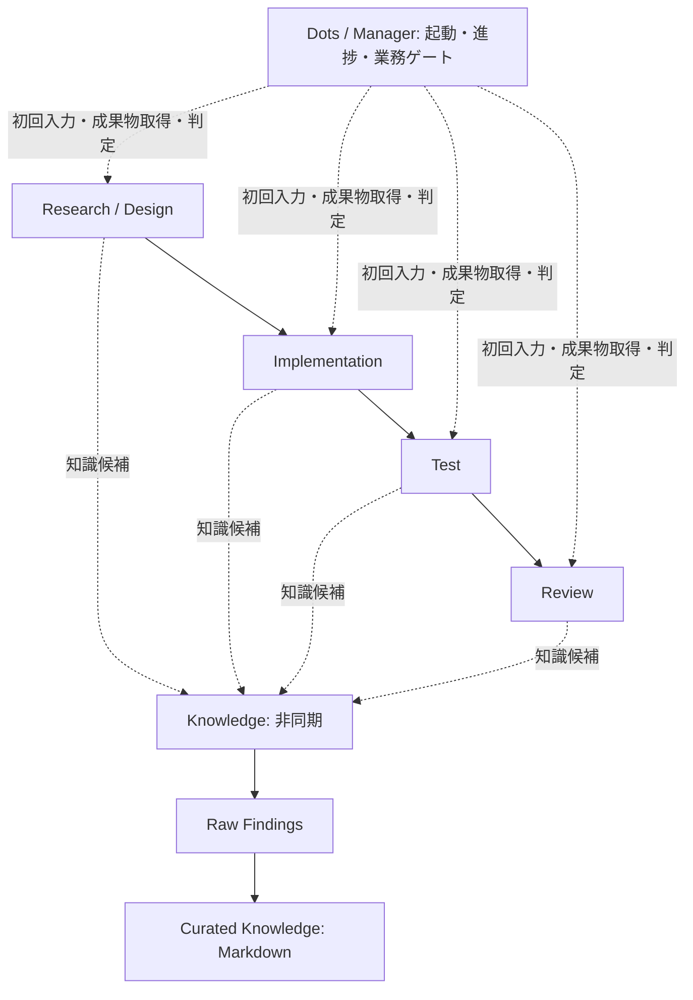

# AI Development System

既存の Dots / Codex Cloud 上で独立タスクを起動し、役割と成果物の契約を明示して AI 開発を進めるための Phase 1-1 設定・運用仕様です。追加 OpenAI API、新規課金サービス、6プロセスの常設は不要です。自動オーケストレーターや Dots 専用 API 連携の実装は含みません。

## アーキテクチャ



矢印は論理依存を示します。実際の引き継ぎは毎回 Manager が成果物を取得・検査して、後続の**初回入力**に明示的に渡します。タスク間の会話やファイルの自動共有を仮定しません。Research→Test の設計検証など、依存関係に応じた短い経路も使えます。

Dots 自身が Manager としてタスク管理と完了判定に専念し、Knowledge Agent が知識の収集・選別・抽象化・管理を非同期に担当します。Knowledge の完了は開発をブロックしません。

## ファイル構成

| パス | 用途 |
| --- | --- |
| [agents/manager.md](agents/manager.md) | 起動・進捗・ゲート・再試行 |
| [agents/research-design.md](agents/research-design.md) | 調査・設計・検証計画 |
| [agents/implementation.md](agents/implementation.md) | 許可された実装 |
| [agents/test.md](agents/test.md) | 独立検証 |
| [agents/review.md](agents/review.md) | 品質・AC・公開安全性レビュー |
| [agents/knowledge.md](agents/knowledge.md) | 非同期の知識管理 |
| [workflows/single-issue.md](workflows/single-issue.md) | 起動、完了検査、明示的引き継ぎ、有限再試行 |
| [contracts/handoff.schema.json](contracts/handoff.schema.json) / [契約説明](contracts/README.md) | JSON Schema と形式検証の限界 |
| [templates/task-input.md](templates/task-input.md) | 役割定義と分離した Issue 固有の初回入力 |
| [templates/knowledge-article.md](templates/knowledge-article.md) / [raw-finding.md](templates/raw-finding.md) | 人間向け記事、AI メタデータ、原根拠 |
| [knowledge/README.md](knowledge/README.md) | raw / curated の技術領域別索引 |
| [examples/README.md](examples/README.md) | synthetic sample: Research→Test と blocked/failed/異常例 |
| [scripts/validate_handoff.py](scripts/validate_handoff.py) / [tests/test_handoff.py](tests/test_handoff.py) | 検証 CLI と回帰テスト |
| [.github/workflows/validate.yml](.github/workflows/validate.yml) | feature Push / PR 時の契約検証 |

## Dots からの利用方法

1. 既存の認可済み Dots / Codex Cloud 環境でこの repo の固定 revision を取得します。対象 repo の AGENTS.md と関連 SKILL.md があれば確認します。
2. Dots 自身が Manager を担当します。Dots に `agents/manager.md`、契約、ワークフローと Issue 固有の依頼・認可済み出典・許可範囲を渡します。別の Manager Cloud タスクを起動する必要はありません。
3. Dots / Manager は全必須 AC 原文・出典と許可範囲を確認し、`templates/task-input.md` に役割定義と Issue 固有情報を明示して、必要な専門役割を独立 Cloud タスクとして起動します。画面/API の名称や起動・回収能力は環境依存です。Dots に必要な操作手段がない環境では、人間が作成済みの初回入力を使って起動・成果物回収を補助します。この制限を二重 Manager の起動で解消したとはみなしません。
4. 終了通知後、Manager が handoff JSON と成果物実体を取得し、形式と業務の両方を検査します。合格した成果物・根拠・AC 原文を後続の初回入力に渡します。
5. 欠落・失敗時は依存後続を停止し、修正後に新しい独立タスクを起動します。各論理工程で初回を含め最大3試行です。必須 AC 原文欠落は `MISSING_ACCEPTANCE_CRITERIA` とし、Manager が認可済み情報源から原文を補完するまで進めません。
6. 実装完了、feature branch の remote SHA、Draft PR、同じ head SHA の CI を個別に確認します。CLI と GitHub 連携は別経路として扱います。main 直接 Push、merge、auto-merge は行いません。

[Research→Test のサンプル](examples/README.md) は起動失敗と修正入力も示します。すべて架空データです。例の `completed` は実際の検証実績を表しません。

## 検証を再現する

Python 3.12 を推奨します。ローカル PC を必要とせず既存 Cloud 作業領域で実行できます。通常のパッケージ取得以外に API やサービスへの接続は不要です。

```bash
python3 -m venv .venv
. .venv/bin/activate
python -m pip install -r requirements-dev.txt
python -m unittest discover -s tests -v
python scripts/validate_handoff.py \
  examples/research-to-test/research.handoff.json \
  examples/research-to-test/test.blocked.handoff.json \
  examples/research-to-test/test.handoff.json \
  examples/failed.handoff.json
```

正常例は exit 0 です。次の異常例は completed の根拠が空なので **exit 1 が期待値**です。

```bash
python scripts/validate_handoff.py examples/invalid-completed.handoff.json
```

テストは completed の必須成果物/根拠/AC 対応、blocked/failed の理由、AC 欠落、型不正・空文字・空白、試行上限、再試行元、ID と参照、CLI 終了コードを検証します。形式検証に通る未裏付けの主張もテストし、真実性を証明できない境界を固定しています。

JSON Schema は構造、CLI の追加検査はローカル ID の参照整合性を扱います。根拠の真実性、AC 原文の完全性、業務 AC 充足、公開安全性は [Manager の業務ゲート](workflows/single-issue.md) で別に検査します。CI 成功も実運用の完了を証明しません。

## 知識ライフサイクル

候補 → Raw Findings（原根拠・観測）→ Knowledge Agent の採否判断 → Curated Knowledge（人間向け Markdown）→ 適用条件・例外・陳腐化の再評価、という流れです。重要判断、失敗、不採用案、出典、更新日と後継リンクを保持します。AI メタデータは本文の補助です。

初期領域は orchestration と validation で、raw / curated の索引を分離しています。詳細は [Knowledge index](knowledge/README.md)。1 Issue=1 PR や repo ごとの知識分割は絶対条件にせず、権限とレビュー範囲に応じて選びます。

## Phase 1-1 の補完判断と制約

- 再試行上限は初回を含む3回とし、工程をまたぐ修正でも同じ論理工程の回数を引き継ぎます。
- handoff は Draft 2020-12、schema_version=1.0。任意の知識候補は空配列を許可します。
- `covered` は役割の担当範囲の完了です。Research の設計完了を製品の AC 合格と誤認しないよう `scope` を必須にしました。
- 初期の技術領域と手動補助可能な Dots 起動手順は最小構成です。実環境での独立タスク起動・配送の統合試験はこの契約テストの対象外です。
- 公開サンプルは synthetic sample と明示し、実際の非公開 task/thread/message ID、私的会話、個人情報、内部メモ、認証情報、運用ログは含めません。実運用の台帳は認可された非公開領域に置きます。
